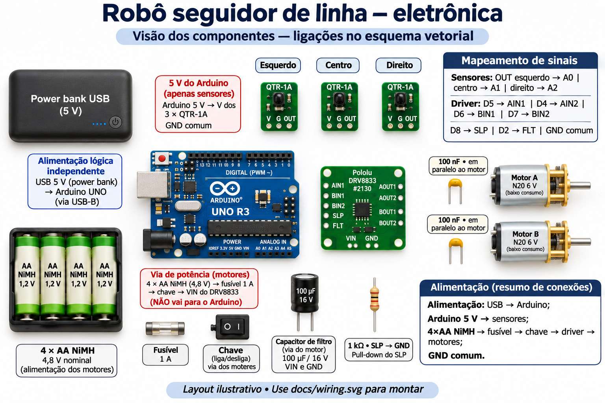

# Arduino line-following robot

[](https://isocpp.org/)
[](https://docs.arduino.cc/hardware/uno-rev3/)
[](https://github.com/arduino/arduino-cli/releases/tag/v1.6.0)
[](https://github.com/arduino/ArduinoCore-avr/releases/tag/1.8.8)
[](LICENSE)
[](https://github.com/kleberandrade/obstacle_avoiding_robot_arduino/actions/workflows/ci.yml)

A small differential-drive robot that follows a dark line on a light floor using an
Arduino Uno R3, three analog reflectance sensors and a dual motor driver. The
repository retains its historical `obstacle_avoiding_robot_arduino` name; this
implementation is a **line follower**, with no obstacle detection.

The firmware starts stopped, requires white/black calibration and an explicit
start command, and stops on line loss, ambiguous patterns or a reported driver
fault. The control logic has no Arduino dependency and runs on a desktop compiler.

## Electronics overview



AI-generated component overview with Portuguese labels. Board shapes and printed
pin positions are illustrative. Use the [exact wiring schematic](docs/wiring.svg)
and [connection table](docs/HARDWARE.md#exact-connections) when assembling the robot.

## Requirements

- Arduino Uno **R3 / ATmega328P**, not Uno R4.
- Hardware listed in [the assembly guide](docs/HARDWARE.md), soldering tools and a multimeter.
- [Arduino CLI 1.6.0](https://github.com/arduino/arduino-cli/releases/tag/v1.6.0).
- Arduino AVR Boards **1.8.8**, pinned in `firmware/line_follower/sketch.yaml`.
  The CLI profile installs the matching core and compiler automatically (Internet
  required on first build). There are no third-party firmware libraries.
- For host tests: `make` and a C++11 compiler (Clang or GCC).

## Installation and quick start

```sh
git clone https://github.com/kleberandrade/obstacle_avoiding_robot_arduino.git
cd obstacle_avoiding_robot_arduino
make test
make example
make firmware
arduino-cli board list
# Replace PORT with the detected Uno serial port:
arduino-cli upload --profile uno --port PORT firmware/line_follower
arduino-cli monitor --port PORT --config baudrate=115200
```

Keep motor power switched **off** during assembly and upload. Read the exact
[connections, power scheme and commissioning procedure](docs/HARDWARE.md) before
turning it on. `make firmware` builds without needing a connected board. If using
the Arduino IDE instead, select Uno and install AVR Boards 1.8.8; the CLI profile
is the reproducible build used by CI.

## Calibration and use

1. Raise the wheels clear of the floor. Leave motor power off. USB powers the
   Uno and sensors. Set all three sensors about 3 mm above the actual white floor.
2. Send lowercase `w` at 115200 baud. Keep the surface still for the 32-sample
   capture (about 70 ms). All three sensors must see white simultaneously.
3. Put a wide piece of the actual black tape under **all three** sensors and send
   `b`. Each sensor must measure at least 100 ADC counts more on black than white.
   Watch the three raw readings printed every ~200 ms, in left/center/right order.
   Values are 0–1023. If contrast is inadequate, adjust height/shielding and repeat.
4. Place only the center sensor above the track. Turn on motor power, keep the
   wheels raised and send `g`. Verify both wheels rotate **forward**. Send `x`.
   Switch motor power off before reversing either motor's two leads if needed.
5. Place the robot on the floor, center the line, turn on motor power and send `g`.
   Use a USB power bank and an onboard USB serial host if available; alternatively,
   start tethered with ample slack, then power it off before changing supplies.
   Connecting/disconnecting USB can reset the Uno: recalibrate after every reset.

| Command | Effect |
| --- | --- |
| `w` | Stop, capture white on all sensors |
| `b` | Stop, capture black on all sensors |
| `g` | Arm only after both captures, adequate contrast and no active fault |
| `x` | Stop and disarm |
| Other characters | Stop and disarm; CR/LF are ignored |

Calibration is RAM-only. Power-up/reset always requires both captures again.
A stopped robot never resumes automatically when the line returns: reposition it
and send `g`. A USB/serial disconnect alone does **not** stop an already running
robot. Keep the motor switch accessible; it is the physical stop control.

## Control behavior

The decision runs about every 20 ms. For each sensor, a reading at or above the
midpoint of its white and black captures is classified as dark. Bits below are
left/center/right, with `1` meaning dark.

| Pattern | Left PWM | Right PWM | Result |
| --- | ---: | ---: | --- |
| `010` | 120 | 120 | Forward |
| `100`, `110` | 45 | 120 | Turn left |
| `001`, `011` | 120 | 45 | Turn right |
| `000` | 0 | 0 | Lost line; stop and disarm |
| `101`, `111` | 0 | 0 | Ambiguous/split line or intersection; stop and disarm |

PWM is 0–255, not a speed in physical units. Both motors only run forward. During
stop the driver sleeps and the wheels **coast**, so stopping distance is nonzero.
Start with a matte 15–20 mm tape line, sensor centers ~15 mm apart, gentle curves
and a flat indoor surface. These are initial mechanical settings, not measured
performance guarantees. Adjust sensor spacing so a centered line activates only
the center sensor. Tune the two duty values in `controller.h` only after checking
wheel direction and raw sensor contrast. Retest after changes.

## Examples and tests

`make example` executes a deterministic four-frame track demonstration:

```text
left=120 right=120
left=45 right=120
left=120 right=45
left=0 right=0
```

`make test` checks all eight sensor patterns, threshold and minimum-contrast
boundaries, invalid ADC/calibration input, and firmware commands using simulated
Arduino I/O. The boundary tests check that missing calibration, line loss and a
driver fault prevent motion and that restarting requires `g`. Assertions remain
enabled in the Makefile. CI runs host tests/example and a real AVR cross-compile.

See [validation results and limitations](docs/VALIDATION.md) and the
[work log](docs/WORK_LOG.md). No physical robot was available for these tests.

## Project layout

- `firmware/line_follower/`: sketch, pure controller and pinned board profile.
- `tests/`: host behavior and simulated firmware I/O tests.
- `examples/track.cpp`: executable controller example.
- `docs/HARDWARE.md`: BOM, connections, electrical checks and bench procedure.
- `docs/wiring.svg`: original vector wiring diagram (net labels define connections).
- `.github/workflows/ci.yml`: host and Uno builds.

## Real limitations

This is a threshold-based educational controller: no PID, encoder feedback,
reverse recovery, automatic route selection or obstacle avoidance. It cannot
identify cliffs, people or obstacles. Analog sensors cannot reliably distinguish
a disconnected sensor from a real surface; the input checks are numeric checks,
not wiring diagnostics. Ambient IR, shiny floors, battery voltage, wheel friction
and motor mismatch affect tracking. There is no hardware watchdog, independent
emergency brake or guarantee of bounded stop time if the MCU hangs. Do not use
near stairs, roads or fragile objects. Bench commissioning remains required.

## License

[MIT](LICENSE), preserving Copyright (c) 2019 Kléber de Oliveira Andrade. Code and
the original diagram added here use the same license. Manufacturer documents and
toolchain components retain their respective licenses; they are linked rather
than copied into this repository.
