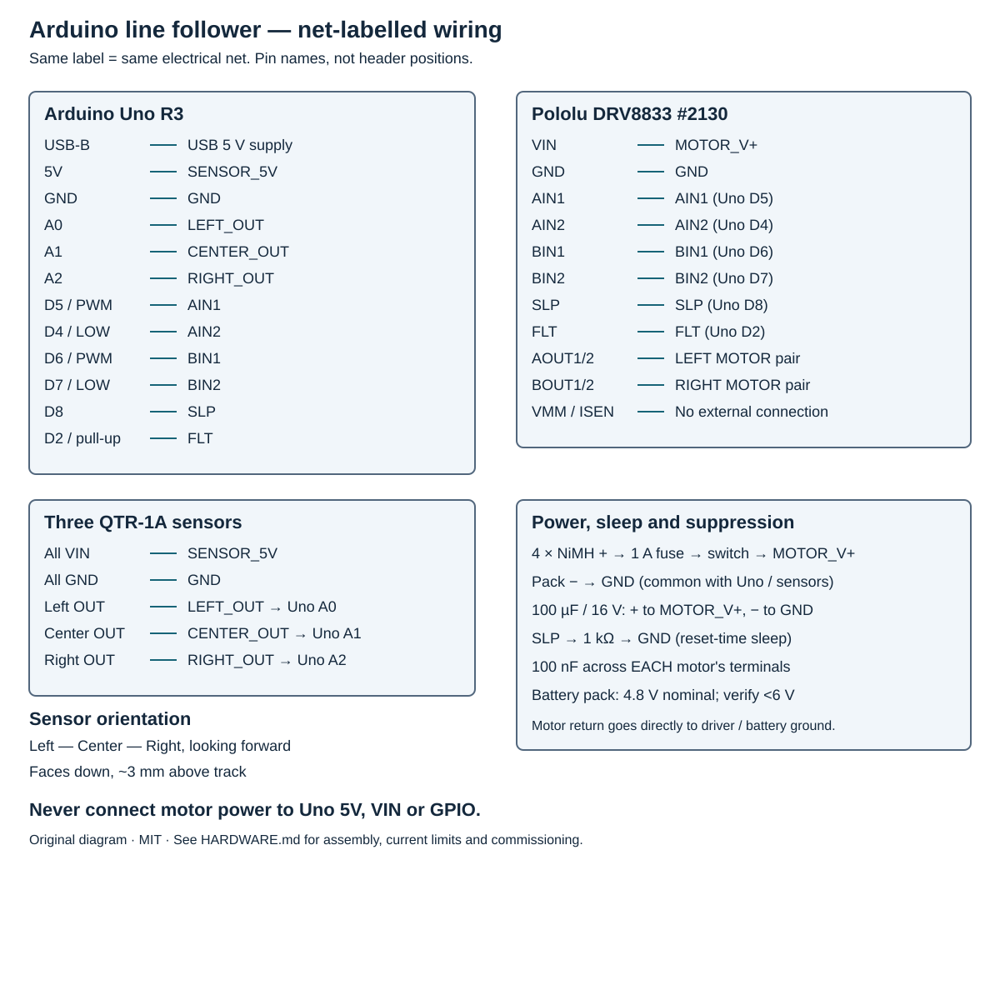

# Hardware and commissioning

## Bill of materials

| Quantity | Part | Selection notes |
| ---: | --- | --- |
| 1 | Arduino Uno R3 | 5 V ATmega328P board, USB-B cable |
| 3 | Pololu QTR-1A analog reflectance sensors | #2458 comes in packs of two: buy two packs, one spare; not QTR-1RC |
| 1 | Pololu DRV8833 dual motor driver carrier #2130 | Use this carrier's named pins; other breakouts can differ |
| 2 | Pololu 100:1 Micro Metal Gearmotor LP 6V #992 | 0.36 A stall at 6 V per manufacturer; matched wheels and brackets |
| 1 set | Chassis, two wheels, caster, sensor bracket | Keep electronics insulated from metal chassis |
| 1 | Four-cell AA NiMH holder and charged NiMH cells | 4.8 V nominal, verify actual pack voltage is below 6 V |
| 1 each | Motor power switch, 1 A fuse and holder | Switch and wiring rated at least 1 A DC; fuse near battery positive |
| 1 | USB 5 V supply/power bank | Rated at least 500 mA; avoid auto-shutoff types |
| 1 | 100 µF electrolytic, at least 16 V | Across driver VIN/GND close to carrier, observe polarity |
| 2 | 100 nF ceramic capacitors | One directly across each motor's terminals |
| 1 | 10 kΩ resistor | SLP to GND, holds driver asleep during reset despite carrier pull-up |
| As needed | Headers, soldered wire, connectors, cable ties | Short motor-current paths; no loose motor breadboard wiring |

Choose substitutions by **stall current at the actual maximum supply voltage**,
not by no-load current. Do not substitute high-power micro motors or unknown TT
motors without checking their data. Do not deliberately stall a motor: that can
damage it even if the driver survives. The fuse protects supply wiring; it is not
a precision motor current limiter.

## Electrical basis and primary sources

Sources checked during implementation (2026-11-15):

- [Uno R3 official specifications](https://store.arduino.cc/products/arduino-uno-rev3):
  5 V logic, PWM on D3/D5/D6/D9/D10/D11, recommended 20 mA per GPIO. The two
  PWM outputs here are D5/D6. Motors must never connect to a GPIO or the Uno 5 V rail.
- [QTR-1A #2458](https://www.pololu.com/product/2458): 5 V supply, roughly 17 mA
  each and analog output between GND and VIN; dark surfaces yield higher voltage.
  Three sensors draw roughly 51 mA from the 5 V supply, not from GPIO. Their output
  range matches the Uno's default 5 V ADC reference. Start at 3 mm sensing height.
- [DRV8833 carrier #2130](https://www.pololu.com/product/2130): 2.7–10.8 V motor
  input, 5 V compatible controls, approximately 1.2 A continuous per channel
  (thermal conditions matter). Its default current limiting is disabled.
  SLP is pulled high on this specific carrier; the external 10 kΩ pull-down and
  D8 control hold it low during reset. FLT is open drain, hence D2 INPUT_PULLUP.
- [TI DRV8833 datasheet](https://www.ti.com/lit/ds/symlink/drv8833.pdf): with
  xIN2 low, PWM on xIN1 alternates forward drive and coast. SLP low sleeps both
  bridges. Output polarity must be matched to the installed motor orientation.
- [Motor #992 specifications](https://www.pololu.com/product/992/specs): rated
  6 V, 0.36 A stall per motor at 6 V. A pack below 6 V stays within that motor
  voltage; its stall demand is comfortably below this carrier's channel rating.
  The 2 A driver peak rating is not a continuous operating target.

The voltage/current compatibility conclusions are design calculations from these
sources; they are not measurements on an assembled robot.

## Exact connections

Disconnect USB and batteries before wiring. Pin labels below match the firmware.
Left/right are viewed from behind the robot, looking forward.

| From | To | Purpose |
| --- | --- | --- |
| Uno 5V | All three QTR VIN | Sensor power only |
| Uno GND | All QTR GND, driver GND, battery negative | Common signal/power reference |
| Left QTR OUT | Uno A0 | Left analog input |
| Center QTR OUT | Uno A1 | Center analog input |
| Right QTR OUT | Uno A2 | Right analog input |
| Uno D5 | Driver AIN1 | Left PWM |
| Uno D4 | Driver AIN2 | Always LOW |
| Uno D6 | Driver BIN1 | Right PWM |
| Uno D7 | Driver BIN2 | Always LOW |
| Uno D8 | Driver SLP (nSLEEP) | HIGH only while commanded to move |
| Driver SLP | 10 kΩ resistor to GND | Reset-time sleep |
| Driver FLT (nFAULT) | Uno D2 | Active LOW, internal pull-up enabled |
| Driver AOUT1/AOUT2 | Left motor's two terminals | Swap leads, power off, if backward |
| Driver BOUT1/BOUT2 | Right motor's two terminals | Swap leads, power off, if backward |
| NiMH pack + | 1 A fuse → motor switch → driver VIN | Motor power only |
| Driver VIN / GND | 100 µF capacitor + / − | Local bulk decoupling |
| Each motor's terminals | 100 nF ceramic across terminals | Brush-noise suppression |
| USB supply | Uno USB-B | Logic power |

Leave driver VMM, AISEN and BISEN untouched/unconnected externally. Do not connect
battery positive to Uno VIN, barrel jack or 5V. Do not connect Uno 5V to driver VIN.
Return motor current directly to driver/battery ground with short wires; branch a
separate ground wire to the Uno so heavy current does not flow through sensor
wiring. Charge cells outside the robot using an appropriate NiMH charger.

The diagram is a wiring schematic, not a physical header-position drawing. Match
printed pin names, not apparent geometric placement. The same net name denotes
an electrical connection throughout the diagram.

## Mechanical assembly

Mount two motors on opposite sides of a light chassis and a caster for the third
support point. Secure the batteries low, away from rotating wheels. Mount three
sensors facing down in a straight row, ahead of the drive axle, at equal height
(~3 mm), roughly 15 mm apart. A centered 15–20 mm tape line should activate only
the center sensor. Protect sensor faces from direct sunlight. Insulate solder
joints and strain-relieve USB and motor cables. Adjust the bracket before tuning
PWM: poor geometry cannot be corrected reliably in software.

## Bench acceptance procedure (must be performed by the builder)

1. With power removed, check wiring continuity, polarity, capacitor polarity and
   absence of shorts. Check that battery positive has no path to Uno 5V. Verify
   the fuse and switch interrupt the motor supply.
2. With USB only, measure 5 V at sensor VIN/GND and verify SLP remains low after
   reset. Motors must stay still; confirm stable raw readings on black and white.
3. Capture `w` then `b` with all sensors over each surface. Verify at least 100
   counts of contrast per channel and the correct left/center/right ordering by
   moving a small tape sample under each sensor separately.
4. Raise wheels. Switch motor supply on, check its voltage (<6 V) and send `g`
   over a center-only line. Both wheels should run forward. Send `x`; they should
   coast to rest. Correct reversed motor wiring only after removing motor power.
5. Move the line left/right; verify the wheel on that side slows. Remove the line
   or cover all sensors black: motion must stop and remain stopped after the
   centered line returns until another `g`.
6. Reset the Uno with wheels raised. It must stop and refuse `g` until both
   captures are repeated. Do not simulate driver faults by shorting outputs;
   fault handling is covered only by simulated I/O here.
7. Test slowly on a flat enclosed track, switch within reach. Check loose wires,
   driver/motor temperature and motor supply sag. Switch off on heat, stuttering
   or unexpected motion. Record observed behavior before declaring a build ready.

## Troubleshooting

- **Refuses start:** repeat both captures since last reset, check black > white,
  contrast and FLT. Inspect power/thermal conditions before clearing a fault.
- **Immediate stop:** `000`, `101` or `111` is present; inspect spacing and raw values.
- **Steers away:** confirm A0 is physically left; verify both motors drive forward.
- **Resets/jitter:** charge cells, shorten/twist motor wires, check ground routing
  and suppression capacitors. Do not power motors from USB or Uno 5V.
- **Will not move at low duty:** check mechanical drag and battery voltage first;
  increase duty cautiously, rerun tests and repeat raised-wheel checks.
